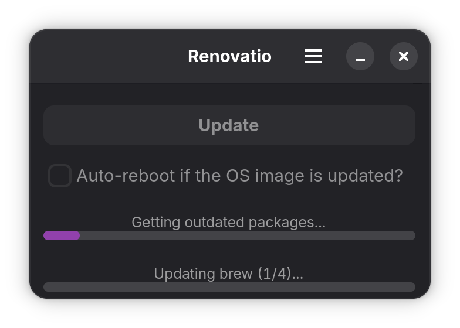
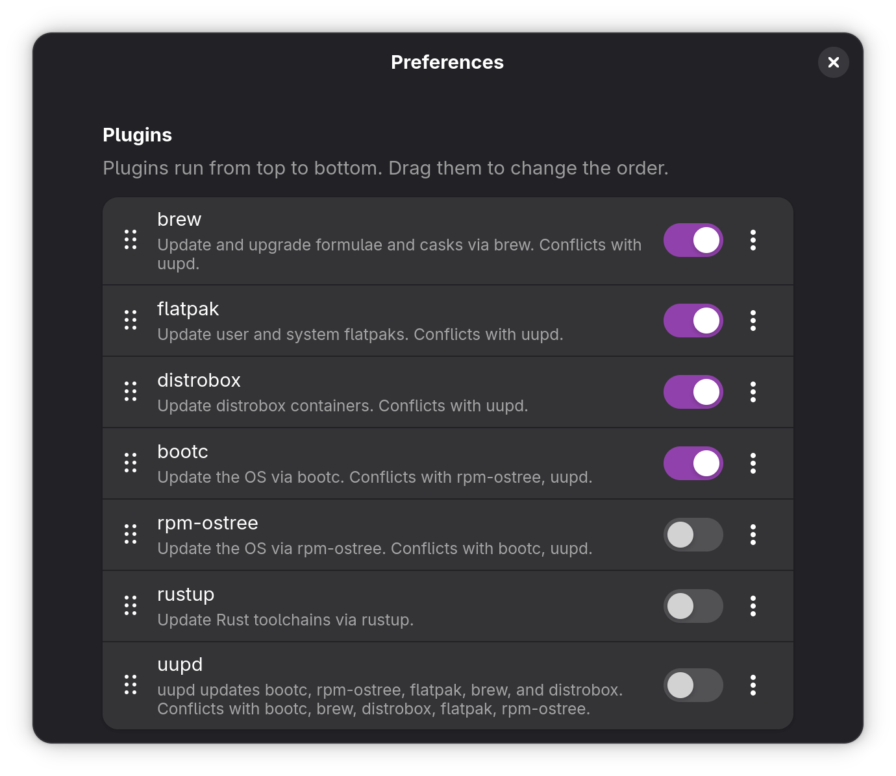

# Renovatio

Prototype gtk4 application to update the OS, flatpak, brew, etc, show a progress bar based on the parsed terminal output (from `uupd --json`), and possibly (stretch goal) display the changelog(s).

- re changelogs: @AdamIsrael it'd be just snagging/caching the release notes from github releases.

## Screenshots

<p align="center">
  
</p>

Each plugin's progress is shown in the upper bar, and the overall run in the lower one.

<p align="center">
  
</p>

In Preferences, switch plugins on or off and drag them into the order they should run in. Plugins that update the same things (e.g. uupd and flatpak) can't be enabled together.

## Building

Until the packaging is complete, you'll have to build the application from source.

### Prerequisites

Dependencies are managed via devcontainer.

- Install DevPod: https://devpod.io/docs/installation

### Setup

```bash
git clone https://github.com/adamisrael/renovatio.git
devpod up .
ssh renovatio.devpod

# Build the application and the plugins
cargo build --workspace --release

# Install the plugins
cd plugins
just install-release

# Run the application
cd ..
target/release/renovatio
```


## TODO

- Investigate feasibility of adding a changelog display feature.
- Add support for `gettext`
- Re-add terminal output for stdout/stderr.
- Build flatpak(s)
